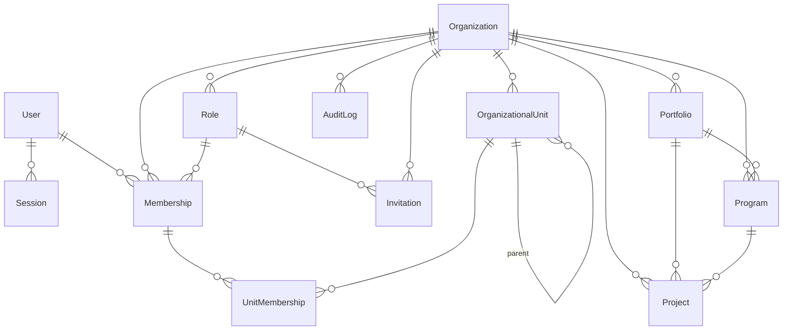

# 05 — Modèle de données relationnel

Source de vérité : `prisma/schema.prisma` et `prisma/migrations/`.

## Principes (appliqués)
- Identifiants `cuid` ; clés étrangères explicites ; index sur `organizationId` et les filtres fréquents.
- **Toute ressource métier porte `organizationId`.**
- Codes uniques **par organisation** (`@@unique([organizationId, code])`).
- Horodatage (`createdAt`, `updatedAt`), auteurs (`createdById`, `updatedById`).
- **Soft delete** (`deletedAt`) sur les entités métier ; le journal d'audit n'est jamais supprimé par l'application.
- Montants en `Decimal(18,2)` + devise ISO à 3 lettres.
- Transactions pour toute écriture accompagnée d'un audit.

## Schéma implémenté

| Entité | Rôle | Contraintes clés |
|---|---|---|
| `User` | Personne (peut appartenir à plusieurs organisations) | email unique |
| `Session` | Session de connexion | id = SHA-256 du jeton ; index expiration |
| `Organization` | Tenant | `code` unique global |
| `Role` | Rôle configurable par organisation, liste de permissions | unique (organisation, key) |
| `Membership` | Appartenance utilisateur ↔ organisation, rôle, statut | unique (user, organisation) |
| `OrganizationalUnit` | Direction, département, bureau… (arbre) | cycles refusés par le service |
| `UnitMembership` | Rattachement d'un membre à 0..n structures | clé composite |
| `Invitation` | Invitation à rejoindre | `tokenHash` unique, expiration, statut |
| `AuditLog` | Journal d'audit (action, entité, résumé, changements JSON) | index (organisation, date) et (entité, id) |
| `Portfolio`, `Program`, `Project` | Hiérarchie d'intervention | unique (organisation, code) ; soft delete |

## Modèle cible (phases suivantes)
Entités prévues, regroupées par phase (noms du master prompt) :
- **Phase 2** : `StrategicPlan`, `StrategicAxis`, `StrategicObjective`, `ProjectObjectiveContribution` (n-n pondéré).
- **Phase 3** : `Phase`, `Activity`, `Task`, `Milestone`, `Deliverable`, `Dependency`, `ProjectMember` (périmètre de permissions), `Stakeholder`.
- **Phase 4** : `Logframe`, `LogframeItem` (+ versions), `TheoryOfChange` (nœuds/liens), `Result`, `Indicator`, `IndicatorTarget`, `IndicatorValue` (période, source, statut de validation), `Disaggregation`, `DataCollection`, `Evaluation`, `EvaluationFinding`, `LessonLearned`, `FeedbackCase` (permissions renforcées).
- **Phase 5** : `Budget`, `BudgetLine`, `BudgetRevision`, `Donor`, `FundingAgreement`, `Disbursement`, `Commitment`, `Expense`, `FinancialDocument`, `ExchangeRate` ; `Risk`, `RiskAssessment`, `MitigationAction`, `Incident`, `RiskMatrixConfig`.
- **Phase 6** : `Document`, `DocumentVersion`, `DocumentPermission`, `DocumentTag`, `KnowledgeChunk` (vecteur pgvector), `SourceCitation`.
- **Phase 7** : `Dataset`, `DatasetVersion`, `Variable`, `DataTransformation`, `Analysis`, `AnalysisResult`, `Visualization`.
- **Phase 8** : `Conversation`, `Message`, `ToolExecution`, `AIAction` (confirmation), `MemoryItem`.
- **Phase 9–10** : `Dashboard`, `DashboardWidget`, `Presentation`, `Slide`, `Report`, `ReportVersion`, `Export`, `ShareLink`, `Comment`, `Notification`, `Approval`, `Workflow`, `WorkflowRun`.

Règles de données sensibles (phase 4+) : une valeur d'indicateur **validée** devient immuable (correction = nouvelle valeur qui remplace, historisée) ; un rapport **validé** n'est jamais modifié silencieusement (nouvelle version).

## Permissions côté base (proposition, phase 11)
Politiques RLS PostgreSQL basées sur `current_setting('app.organization_id')` positionné par transaction, en complément des contrôles applicatifs.
