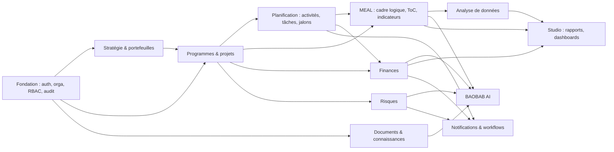

# 01 — Analyse du cahier des charges BAOBAB

## 1. Lecture d'ensemble

Le master prompt décrit un **système intégré de pilotage** et non une collection d'outils. Sa colonne vertébrale est une chaîne de valeur :

```
Stratégie → Portefeuille → Programme → Projet → Planification → Exécution
→ Résultats → Indicateurs → Données → Analyse → Décision → Action → Impact
```

Trois propriétés structurent tout le produit et doivent exister **avant** les modules métier :

1. **Un modèle de données commun** où chaque objet appartient à une organisation et peut être relié à d'autres (y compris en plusieurs-à-plusieurs).
2. **Des permissions et une isolation des organisations vérifiées côté serveur**, que l'IA, les exports et les partages devront aussi respecter.
3. **La traçabilité** (audit, versions, données validées non modifiables silencieusement).

C'est pourquoi la première tranche livrée porte sur ces fondations (phases 0–1) puis sur la colonne vertébrale Portefeuille → Programme → Projet.

## 2. Incohérences et ambiguïtés relevées

| # | Constat | Traitement proposé | Statut |
|---|---|---|---|
| I1 | « Un projet peut contribuer à plusieurs objectifs stratégiques » mais la hiérarchie Programme → Projet est présentée comme parent-enfant. | Rattachement **hiérarchique unique** (0..1 programme, 0..1 portefeuille) + **contributions plusieurs-à-plusieurs** vers les objectifs stratégiques (table de liaison, phase 2). | Décision confirmée (hiérarchie) / Proposition (contributions) |
| I2 | Un projet peut-il appartenir à plusieurs programmes ? Le texte évoque des doubles comptages « lorsqu'un projet contribue à plusieurs programmes ». | Appartenance à **un seul** programme ; les contributions multiples passent par des liens de contribution pondérés, exclus des sommes budgétaires pour éviter le double comptage. | Point à arbitrer |
| I3 | Portefeuille du projet vs portefeuille du programme : deux sources possibles. | Un projet rattaché à un programme **hérite** du portefeuille du programme ; incohérence refusée ; déplacer un programme déplace ses projets. | Décision confirmée (implémentée et testée) |
| I4 | « Progression » utilisée sans définition (temps ? activités ? indicateurs ?). | Trois mesures distinctes et jamais confondues : avancement **temporel**, **exécution budgétaire**, **taux d'atteinte** des cibles. Seule la première est calculable aujourd'hui. | Décision confirmée |
| I5 | Budgets consolidés multi-devises (XOF, EUR, USD fréquents). | Aucune conversion implicite : totaux **par devise**. Conversion future via une table de taux datés et une devise de reporting. | Décision confirmée / Proposition |
| I6 | « Supabase Auth ou équivalent » + « Row Level Security ». | Auth par sessions serveur intégrée (pas de dépendance externe non configurable dans l'environnement) ; isolation dans la couche service. RLS PostgreSQL en défense en profondeur (phase 11). | Décision confirmée (ADR-002) |
| I7 | La fiche projet prévoit 11 onglets dont 8 dépendent de modules futurs. | Les onglets non disponibles sont visibles mais désactivés (« Bientôt ») : pas de route morte, pas de faux contenu. | Décision confirmée |
| I8 | Formulaire projet en 11 étapes ; les étapes 8 à 10 (équipe, risques, MEAL) n'ont pas encore de modèle. | Assistant en 7 étapes + vérification ; les étapes manquantes seront ajoutées avec leurs modules. | Décision confirmée |
| I9 | Monorepo `apps/ packages/ services/` proposé, mais « ne pas créer de dossiers vides ». | Application unique modulaire ; extraction en paquets quand un second consommateur existera (workers, API publique). | Décision confirmée (ADR-001) |
| I10 | Rôles « configurables » mais aussi une liste fixe de rôles. | Rôles **système** créés par organisation (modifiables sauf Propriétaire) + rôles **personnalisés**. | Décision confirmée |
| I11 | Permissions « par périmètre » (projet, programme) mais RBAC décrit au niveau organisation. | Phase 1 : RBAC au niveau organisation. Périmètres (affectation à des projets/programmes) : phase 3 pour l'équipe projet, phase 11 pour les permissions avancées. | Proposition |
| I12 | Envoi d'emails (invitations, notifications) sans fournisseur défini. | Invitations par **lien affiché une seule fois** à l'administrateur, clairement signalé ; fournisseur email à choisir. | Point à arbitrer |

## 3. Dépendances entre modules



Conséquence : l'IA et le Studio arrivent **après** les modules qui produisent les données qu'ils exploitent ; sinon ils ne pourraient que simuler, ce que le cahier des charges interdit.

## 4. Risques techniques et produit

| Risque | Impact | Mitigation |
|---|---|---|
| Fuite de données entre organisations | Critique | Contexte tenant obligatoire dans chaque service ; références croisées vérifiées ; tests multi-tenant automatisés ; RLS en défense en profondeur (phase 11) |
| Périmètre très large → produit « maquette » | Élevé | Tranches verticales complètes, critères d'acceptation stricts, modules futurs affichés comme tels |
| Calculs agrégés trompeurs (moyennes simples, devises mélangées) | Élevé | Formules documentées et testées (`docs/product/business-rules.md`) |
| IA hallucinant des chiffres | Élevé | Moteur statistique déterministe, outils IA appelant les services métier avec les droits de l'utilisateur, citations obligatoires |
| Données sensibles (redevabilité, santé) | Élevé | Permissions renforcées dédiées, chiffrement, journalisation des accès (phase 4) |
| Connectivité limitée sur le terrain | Moyen | Pages légères rendues côté serveur ; collecte hors-ligne via KoboToolbox/ODK plutôt que réimplémentation |
| Comportements du routeur client Next.js 15 | Moyen | Constatés en test navigateur et contournés (ADR-004) ; parcours E2E en non-régression |
| Statistiques avancées en TypeScript | Moyen | Service Python dédié (statsmodels/scipy) derrière une API interne (phase 7) |

## 5. Arbitrages

### Tranchés par le porteur de projet (2026-11-03)
| Sujet | Décision | Mise en œuvre |
|---|---|---|
| Modèle commercial | Essai gratuit, puis payant | Essai de 30 jours, 4 plans, lecture seule après l'essai : [tarification.md](tarification.md), ADR-005 |
| Projet multi-programmes (I2) | Chaque projet appartient à un seul programme ; deux projets doivent être distinguables | Code unique dans l'organisation (déjà en place) + nom unique dans un même programme (nouveau, testé). Un même intitulé dans deux programmes = deux projets distincts aux codes différents |
| IA | Utiliser l'IA de manière responsable et respectueuse | [charte-ia.md](charte-ia.md) (phase 8) |
| Langues | Toutes les langues possibles, y compris les langues nationales | Multilingue en place (fr, en, wolof bêta) : [langues.md](langues.md), ADR-006 |

### Restant à arbitrer
1. **Agrégateur de paiement** (Wave/Orange Money via PayDunya, CinetPay… ; cartes via Stripe) et facturation/TVA.
2. **Fournisseur email** (invitations, réinitialisation de mot de passe) et **hébergement** (Vercel + PostgreSQL managé, ou hébergement en Afrique de l'Ouest pour la souveraineté des données).
3. **Fournisseur d'IA** principal (proposition : architecture multi-fournisseurs, en commençant par un seul fournisseur avec engagement de non-réutilisation des données).
4. **Relecteurs natifs** pour valider le wolof, puis les autres langues nationales.
5. **Validation des prix** auprès de 5 à 10 organisations pilotes pendant l'essai.
