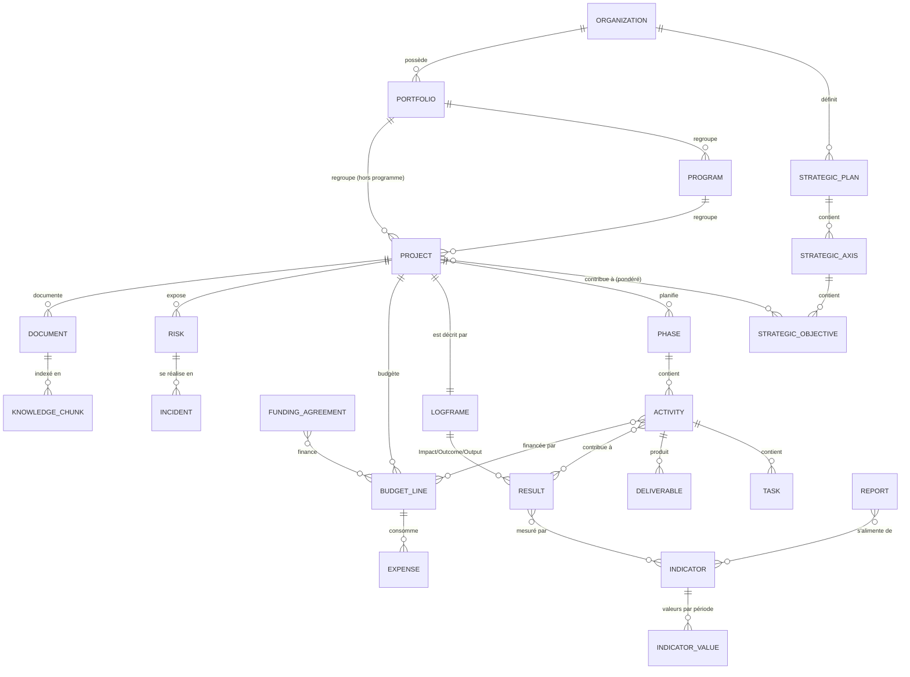

# 03 — Architecture fonctionnelle

## Modules et sous-modules
La navigation cible (A à M du master prompt) est conservée intégralement dans `src/app/(workspace)/nav.ts`. Les modules non construits y figurent avec leur phase prévue et sont non cliquables.

| Module | Sous-modules livrés | Sous-modules prévus |
|---|---|---|
| A. Tableau de bord | Vue consolidée, alertes, activité récente, premiers pas | Vues par rôle (Direction, Chef de projet, MEAL, Finance) |
| B. Organisation | Vue d'ensemble, profil, structures, membres, rôles & permissions, audit | Gouvernance (comités, circuits de validation, délégations), paramètres |
| C. Stratégie & portefeuilles | Portefeuilles | Plans, axes, objectifs stratégiques, alignement, arbitrages |
| D. Programmes & projets | Programmes, projets, assistant, fiche, santé, cycle de vie | Activités, tâches, livrables, jalons, dépendances, Gantt, Kanban, calendrier, clôture |
| E. MEAL | — | Cadre logique, ToC, indicateurs, collecte, qualité, évaluations, redevabilité, apprentissage |
| F. Finances | Budget prévisionnel indicatif (projets, programmes, portefeuilles) | Lignes, financements, dépenses, engagements, décaissements, variances |
| G. Risques | — | Registre, matrice, mitigation, incidents |
| H. Analyse de données | — | Import, dictionnaire, qualité, statistiques, visualisations |
| I. Documents | — | Bibliothèque, versions, RAG, citations |
| J. BAOBAB AI | — | Assistant général, mode Expert, outils sécurisés |
| K. Studio | — | Dashboards, présentations, rapports, partages |
| L–M. Collaboration, Administration | Audit | Commentaires, notifications, workflows, administration plateforme |

## Relations métier (cible)

## Exemple de propagation (cible)
Une activité en retard → livrable en retard → résultat associé menacé → indicateur sous la trajectoire → budget non consommé (sous-exécution) → risque « retard de mise en œuvre » réévalué → alerte au tableau de bord → paragraphe du rapport marqué « à revoir » → contexte disponible pour l'IA. Chaque lien de cette chaîne est une relation explicite du modèle, d'où l'ordre des phases.

## Règles métier fondamentales
Voir `business-rules.md`. Les 20 règles de la partie XVI du master prompt sont reprises ; celles déjà appliquées dans le code sont marquées.
